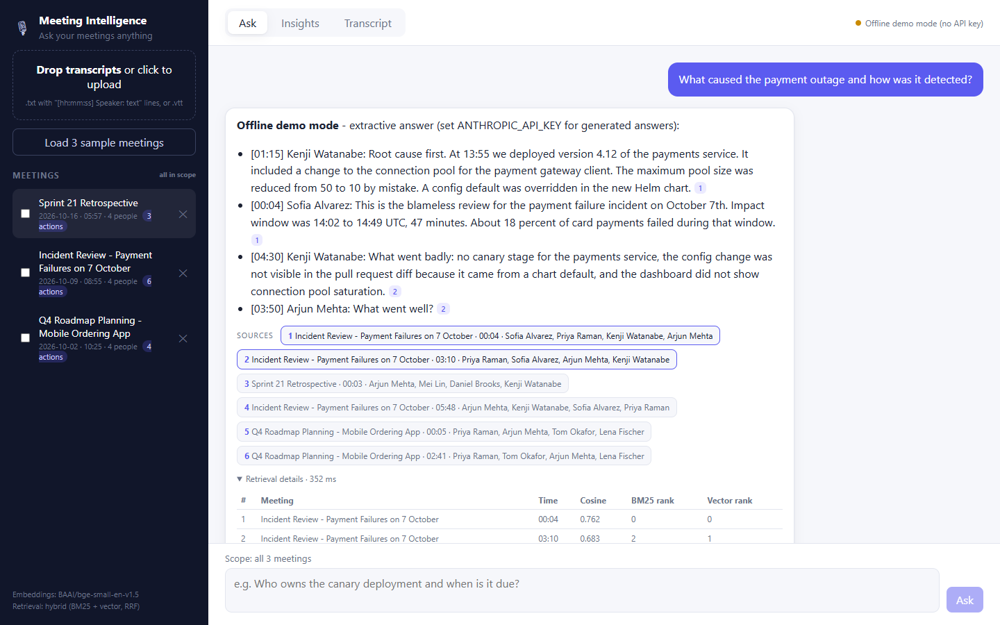
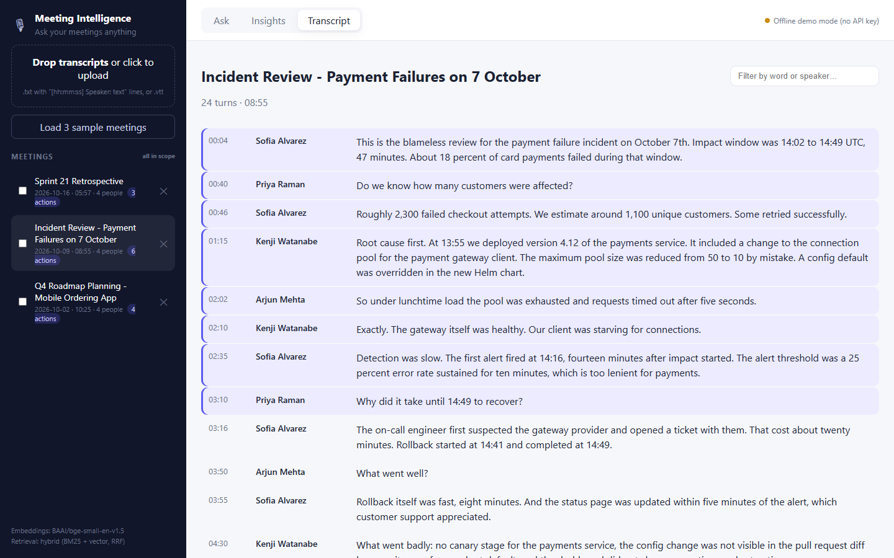
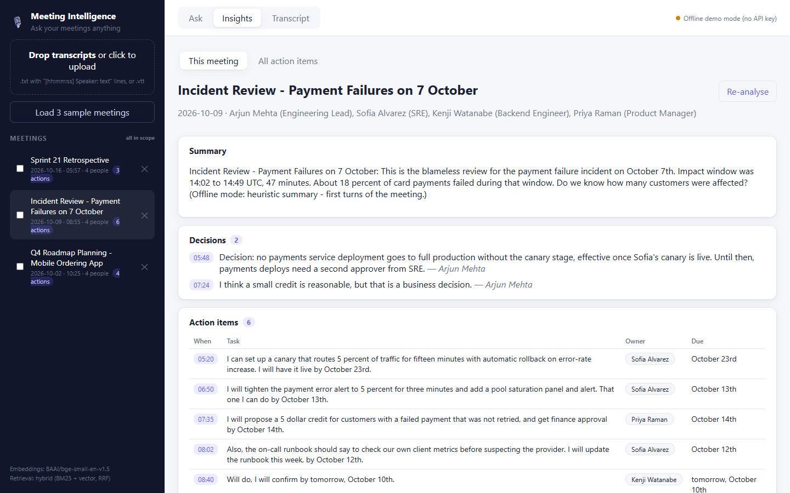
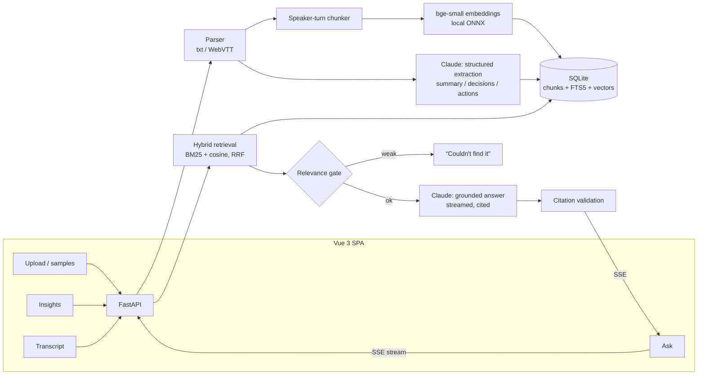

# Meeting Intelligence Assistant

Ask questions about your meetings and get answers grounded in the transcripts, with a clickable citation
to the exact moment each fact was said. The assistant also extracts **decisions, action items (owner +
due date) and open questions** from every meeting, and gives an "all action items by owner" view.

> Assignment option 3 (Meeting Intelligence System), plus the optional voice-to-transcript bonus.



| Ask, with sources and retrieval trace | Jump to the cited moment | Extracted insights |
|---|---|---|
|  |  |  |

*(Screenshots were taken in offline demo mode, without an API key, so answers are extractive; with `ANTHROPIC_API_KEY` set the answers are generated by Claude.)*

---

## Quick start

**Docker (recommended)**
```bash
cp .env.example .env          # optional: add ANTHROPIC_API_KEY for Claude answers
docker compose up --build     # http://localhost:8000  ->  "Load 3 sample meetings"
```

**Local development**
```bash
# backend (Python 3.11+)
cd backend
python -m venv .venv && . .venv/bin/activate        # Windows: .venv\Scripts\activate
pip install -r requirements-dev.txt
export ANTHROPIC_API_KEY=sk-ant-...                 # optional; without it the app runs in offline demo mode
uvicorn app.main:app --reload                       # http://localhost:8000/docs for the API

# frontend (Node 20+), in a second terminal
cd frontend && npm install && npm run dev           # http://localhost:5173 (proxies /api to :8000)
```

**Tests, lint and the retrieval evaluation** (all offline, no API key)
```bash
cd backend
pytest                         # 30 tests: parser, chunker, guardrails, API end-to-end
ruff check . && ruff format --check .
python -m eval.run_eval        # retrieval hit@k / MRR on the golden set (downloads bge-small once)
```

Without an API key the app uses an **offline demo mode**: retrieval and the whole UI work, and answers and
insights come from a simple extractive heuristic that is clearly labelled in the UI. This keeps tests and CI
free of secrets and lets anyone run the demo.

---

## Architecture



**Ingest:** parse → chunk by speaker turns → embed → store (+ FTS index) → extract insights with Claude
into a validated Pydantic schema. The meeting is searchable before extraction finishes, and a failed extraction
doesn't block search.

**Ask:** clean question → (follow-up? combine with the previous question) → hybrid retrieval → relevance
gate → prompt with numbered excerpts → stream Claude's answer over SSE → validate citations → `done` event with
latency, token usage and trace id.

| Path | Responsibility |
|---|---|
| `backend/app/ingest/parser.py` | `[hh:mm:ss] Speaker: text`, `hh:mm:ss Speaker: text`, `mm:ss`, wrapped lines, WebVTT `<v Speaker>` cues, `Meeting/Date/Attendees` headers |
| `backend/app/ingest/chunker.py` | Windows of whole turns (~180 words), 1-turn overlap, time range + speakers per chunk |
| `backend/app/embeddings.py` | `bge-small-en-v1.5` via fastembed (ONNX, CPU); hash embedder for tests |
| `backend/app/store.py` | SQLite: meetings, turns, chunks (+ vectors), FTS5 index; idempotent re-ingest |
| `backend/app/retrieval.py` | Dense + BM25, Reciprocal Rank Fusion |
| `backend/app/llm.py` | Claude (streaming answers, `messages.parse` extraction, prompt caching, refusal fallback) and the offline stand-in |
| `backend/app/prompts.py` | Byte-stable system prompts; excerpts delimited and escaped |
| `backend/app/guardrails.py` | Upload/question limits, injection heuristic, citation validation |
| `backend/app/service.py` | Orchestration of ingest and Q&A |
| `backend/app/observability.py` | JSON logs with trace id, counters + p50/p95 at `/api/metrics` |
| `backend/eval/` | Golden questions + retrieval evaluation script |
| `frontend/src/` | Vue 3: chat with citation chips, insights, transcript with jump-to-time |

### API

| Method | Path | |
|---|---|---|
| `POST` | `/api/meetings` | Upload `.txt` / `.vtt` transcripts (multipart, several at once) |
| `POST` | `/api/meetings/samples` | Load the three bundled sample meetings |
| `GET` | `/api/meetings`, `/api/meetings/{id}`, `/api/meetings/{id}/transcript` | Read |
| `POST` | `/api/meetings/{id}/insights` | Re-run extraction |
| `DELETE` | `/api/meetings/{id}` | Delete |
| `GET` | `/api/action-items` | All action items across meetings, by owner |
| `POST` | `/api/chat` | SSE stream: `retrieval` → `delta`* → `done` (or `error`) |
| `POST` | `/api/transcribe` | Optional: audio → transcript → ingest (`pip install -r requirements-voice.txt`) |
| `GET` | `/api/health`, `/api/metrics` | Ops |

---

## RAG / LLM approach

| Concern | What the code does |
|---|---|
| **Chunking** | Whole speaker turns grouped to ~180 words, last turn repeated in the next chunk. Each chunk keeps start/end time and speakers. |
| **Embeddings** | `BAAI/bge-small-en-v1.5` (384-dim) run locally with fastembed/ONNX, baked into the Docker image. |
| **Vector store** | SQLite: vectors as BLOBs with brute-force cosine, plus FTS5 for BM25. |
| **Retrieval** | Hybrid: top candidates from cosine and BM25, merged with Reciprocal Rank Fusion (k=60), top 6. Optional meeting filter. |
| **LLM** | Claude (`claude-opus-5-5` by default, `MIA_LLM_MODEL` to change). Answers stream at effort `low`; extraction uses effort `medium` with `messages.parse()` into a Pydantic schema. |
| **Prompt & context** | Byte-stable system prompt with `cache_control`. Excerpts are numbered, tagged with meeting/time/speakers and escaped. Last 6 chat turns are sent; short or pronoun-led follow-ups are searched together with the previous question. |
| **Guardrails** | File type/size and question length limits, control-char stripping, relevance gate before the LLM, "excerpts are data, not instructions" rule with delimiter escaping, citation validation, server-side refusal fallback. |
| **Quality** | Golden-set retrieval evaluation (below), ungrounded-answer flag, pytest suite. |
| **Observability** | JSON logs with trace id (also in the `X-Trace-Id` header and the UI), per-answer retrieval scores, token usage and latency; `/api/metrics` counters and p50/p95. |

### Options considered

| Area | Options looked at | Chosen | Why |
|---|---|---|---|
| LLM | Claude, GPT, a local open model (Llama) | Claude | Follows "answer only from these excerpts and cite them" well, gives structured output for extraction, and supports prompt caching. A local model would give weaker answers on a laptop. |
| Embeddings | OpenAI / Voyage embedding APIs, local bge-small | bge-small (local) | Free, works offline, meeting data stays on the machine, and it is good enough on the eval. |
| Vector store | Pinecone, Chroma, FAISS, pgvector, SQLite | SQLite (FTS5 + vectors) | No server to run, and keyword + vector search live in one file. pgvector is the production step. |
| Orchestration | LangChain, LlamaIndex, plain Python | Plain Python | The pipeline is small (parse → chunk → embed → search → prompt). Plain code keeps every step visible and easy to debug and explain. |

### Retrieval evaluation (`python -m eval.run_eval`)

18 answerable questions about the samples, each labelled with the meeting and moment that should be
retrieved, plus 4 off-topic questions. Measured with bge-small, k=6:

| Retrieval | hit@1 | hit@6 | MRR |
|---|---|---|---|
| **Hybrid (BM25 + vector, RRF)** | **0.83** | 1.00 | **0.91** |
| Vector only | 0.50 | 1.00 | 0.71 |
| Keyword only (BM25) | 0.72 | 1.00 | 0.83 |

Best-chunk cosine: answerable questions 0.52–0.80, off-topic 0.43–0.60. The ranges overlap ("price of Bitcoin"
matches the maps-API *pricing* discussion), so the gate is set at **0.50**: it rejects clearly off-topic
questions with no false refusals on this set, and near-misses fall through to the prompt rule *"say you
couldn't find it"*. The sample set is small; see "Next steps".

---

## Productionizing on AWS

| Area | Change |
|---|---|
| Compute | Container on **ECS Fargate** (or App Runner) behind an ALB; long SSE connections need ALB idle timeout ≥ 120 s. The API is stateless once storage moves out. |
| Storage | **RDS PostgreSQL + pgvector** (HNSW index) replaces SQLite; Postgres full-text (`tsvector`) replaces FTS5, so hybrid search stays one query. Transcripts and audio in **S3**. |
| Ingestion | Upload to S3 → **SQS** → worker (Fargate/Lambda) for parse/embed/extract, so uploads return immediately and large files don't block the API. Whisper on a GPU worker if voice is used. |
| LLM | Claude via the Anthropic API or **Amazon Bedrock** (keeps traffic and billing in AWS; the SDK has a Bedrock client). Prompt caching for the system prompt; Message Batches for bulk re-extraction. |
| Secrets & auth | API key in **Secrets Manager**; Cognito / SSO in front; meetings scoped per tenant/user in every query. |
| Observability | OpenTelemetry → CloudWatch / X-Ray; alarms on error rate, p95 latency, refusal and ungrounded-answer rates, token spend. |
| Quality | Larger golden set from real (consented) transcripts, LLM-judged faithfulness/answer-quality evals in CI, feedback buttons in the UI feeding the eval set. |
| Delivery | IaC (CDK/Terraform), CI builds the image → ECR → staged deploy. |

---

> **Note on how the sections below were written:** they were drafted with Claude (an AI assistant), based on
> this project's code and evaluation results, and reviewed by me. The design choices themselves are explained
> in my Loom video.

## Key technical decisions and why

- **Chunking by speaker turns, not fixed size.** A meeting is people taking turns. Cutting every N characters
  can split a sentence in half or mix two speakers. So chunks are built from whole turns (~180 words), the last
  turn is repeated in the next chunk, and every chunk keeps its time range and speakers. That is what makes
  "who said it and when" answerable and lets every citation jump to the right moment.
- **Hybrid search (keyword + vector).** Vector search finds similar *meaning* ("outage" ≈ "payments failed").
  Keyword search finds *exact words*: names, dates, terms like "Helm chart", where vectors are weak. Merging both
  with RRF gave the best result in the eval: hit@1 0.83, against 0.72 for keyword only and 0.50 for vector only.
- **SQLite and local embeddings.** This was a 2-day build, so no extra servers. Brute-force search is fine for a
  few thousand chunks, all storage code is in one class (`store.py`), so moving to pgvector later changes one
  file. Local embeddings are free and keep meeting data private.
- **Relevance gate set from data.** Before calling the LLM, the best match must reach cosine 0.50. Real questions
  scored 0.52–0.80 and off-topic ones 0.43–0.60. The ranges overlap ("Bitcoin price" matched talk about map
  API *pricing*), so the gate stops clearly off-topic questions and the prompt rule "say you couldn't find it"
  catches the near misses. One threshold alone is not enough.
- **Insights extracted once, at upload.** Decisions and action items are saved as structured data, so the
  "all action items by owner" view is instant and consistent instead of asking the LLM every time.
- **Offline demo mode.** Without an API key the app still runs end to end. Tests and CI need no secrets, and
  anyone can try it.
- **Follow-ups without an extra LLM call.** Short or pronoun-led follow-ups are searched together with the
  previous question. Cheaper and faster, but less robust than asking the LLM to rewrite the question.

## Engineering standards

**Followed:** typed Pydantic models; thin routes with the logic in a service layer; settings only from
environment variables; 30 offline tests plus a retrieval eval; ruff lint and format; CI that runs lint, tests,
an eval smoke test, the front-end build and the Docker build; a non-root container with a health check and the
model baked in; JSON logs with a trace id on every request.

**Skipped, and why:**
- *Authentication:* single-user demo. Needed before any real use (see "Productionizing").
- *Database migrations:* the schema was still changing; SQLite is created on start.
- *Front-end tests:* time. The risky logic (parsing, retrieval, guardrails) is in the backend and is tested.
- *Rate limiting and load testing:* not useful for a local demo; required before production.

## How I used AI tools

- I used **Claude Code** as the coding assistant for this project (the commits record it). It wrote most of the
  code, the tests and the first drafts of the documentation, including the sections above.
- **`CLAUDE.md`** holds the project rules the assistant must follow: where each responsibility lives (only
  `store.py` talks to SQLite, only `llm.py` talks to the Anthropic SDK), byte-stable prompts, every change
  comes with an offline test, and run the eval when retrieval changes. This keeps the AI's output consistent
  and makes the process repeatable for anyone who picks the repo up.
- **Checks on AI output:** the test suite, ruff, CI, and the retrieval eval. Numbers such as the hybrid-search
  gain and the 0.50 threshold come from running the eval, not from the assistant's opinion.
- **Do's:** give the assistant written project rules; ask for tests with every change; verify claims by running
  code. **Don'ts:** accept numbers or thresholds without measuring them; let it add dependencies without a reason.

## What I'd do differently with more time

1. **A bigger, real evaluation set.** 18 questions on synthetic meetings is too small; the threshold and
   retrieval should be re-tuned on real (consented) transcripts, with LLM-judged answer quality.
2. **A re-ranker** (cross-encoder) on the top results to improve ordering.
3. **pgvector and background ingestion** so large uploads don't block the API and search scales.
4. **Speaker detection for audio:** Whisper labels everything "Speaker".
5. **Login, per-user data, and thumbs up/down feedback** that feeds the eval set.

## Known limitations

- Speaker labels and timestamps are required in text transcripts; free-form notes are rejected with a clear error.
- Voice transcription labels everything "Speaker" (no diarization).
- Brute-force vector search is fine to roughly 100k chunks; beyond that use pgvector/HNSW.
- The relevance threshold was tuned on a small synthetic set and should be re-tuned on real data.
- Offline mode is a demo aid, not an AI answer.
